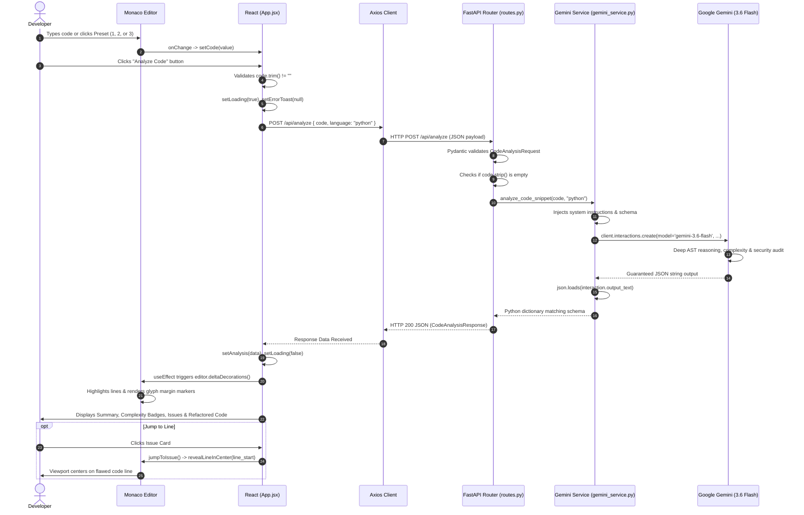
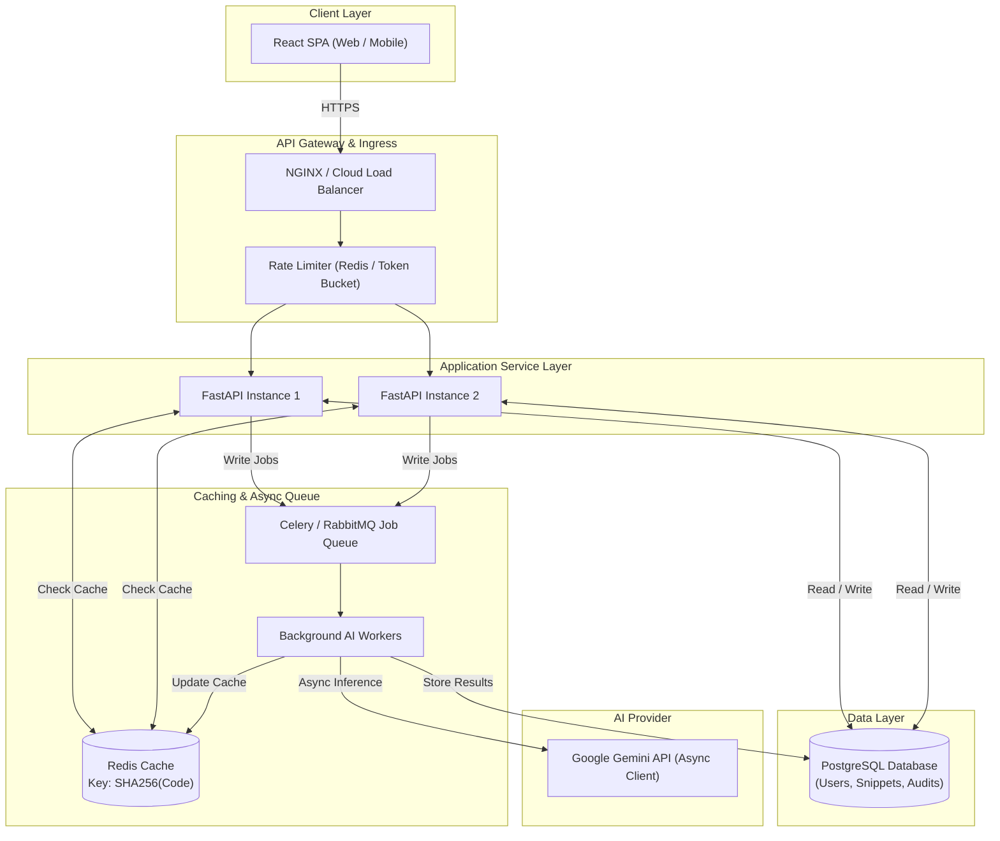

# AI Code Explainer & Refactorer — Comprehensive Internship Interview Preparation Guide

---

# PART 1 — PROJECT AT A GLANCE

### Project Summary
* **Project Name:** AI Code Explainer & Refactorer (Repository: `Ai-Code-Explainer`)
* **Project Type:** Full-Stack Developer Tooling / Static Analysis Single Page Application (SPA)
* **Problem Solved:** Traditional linters flag formatting and syntax rules but cannot semantically evaluate algorithmic complexity (Big-O Time & Space), detect multi-line security flaws (SQL Injection, Path Traversal, Resource Leaks), or generate context-aware, drop-in replacement refactorings.
* **Target Users:** Junior software engineers, students, bootcamp learners, and code reviewers seeking automated code auditing and feedback.
* **Core Functionality:** Web-based IDE code editing (Monaco Editor), pre-configured vulnerability presets, worst-case Big-O complexity analysis, line-bounded security/anti-pattern issue detection, bidirectional jump-to-line editor highlighting, and one-click copyable refactored code.
* **Overall Architecture:** Decoupled client-server architecture: React 18 (Vite 5 + Tailwind CSS v4) frontend communicating over REST (`POST /api/analyze`) with a Python FastAPI backend acting as an API gateway to Google Gemini (`gemini-3.6-flash`) via the `google-genai` SDK using strict Pydantic JSON Schema enforcement.

### 30-Second Interview Explanation
> *"I built **AI Code Explainer & Refactorer**, a full-stack developer tool for automated code auditing and refactoring. The frontend is built in React 18, Vite, and Tailwind CSS, featuring an embedded Microsoft Monaco Editor with dynamic line decorations and glyph margins. The backend is an asynchronous FastAPI service that acts as a secure API gateway to Google's Gemini 3.6 Flash model. I used Pydantic schemas to enforce deterministic structured JSON responses from the LLM, allowing the application to calculate Big-O complexities, pinpoint security vulnerabilities to exact line numbers in the editor, and synthesize clean, drop-in refactored code."*

---

# PART 2 — 1-MINUTE INTERVIEW EXPLANATION

> *"When developers write code, traditional linters only catch syntax or formatting issues, while full human code reviews take time. I built **AI Code Explainer & Refactorer** to provide immediate, deep static analysis directly in the browser.*
> 
> *The user enters Python code into an embedded Monaco Editor or selects one of the pre-loaded vulnerability presets. When they trigger the analysis, our React frontend sends the payload to a FastAPI backend. The backend validates the code and coordinates with Google Gemini's 3.6 Flash model using the Gemini Interactions API.*
> 
> *Rather than dealing with unpredictable markdown text, I enforced a strict Pydantic JSON Schema on the LLM's response. This guarantees structured data containing an execution summary, exact Time and Space Big-O notation, line-specific vulnerability flags with severity tiers, and a complete refactored snippet.*
> 
> *The most interesting technical part is the frontend-editor integration: the React application translates the AI's line ranges into Monaco editor decorations and glyph margin markers. Users can click any issue card in the audit report to automatically scroll and focus the editor on that exact flawed line range.*
> 
> *The project demonstrates full-stack architecture, secure API key isolation on the server, prompt engineering with structured schemas, and rich browser IDE integration."*

---

# PART 3 — 3–5 MINUTE DEEP PROJECT EXPLANATION

> *"I'd like to walk you through the architecture, engineering decisions, and data flow of my project, **AI Code Explainer & Refactorer**.*
> 
> ### 1. Motivation & Problem Space
> *While preparing for software engineering roles and reviewing code, I noticed a gap: standard linters like Flake8 or ESLint check deterministic rules—like unused variables or line length—but they can't evaluate whether an algorithm has an exponential $O(2^N)$ time complexity, whether a raw database query is prone to SQL Injection, or how to idiomaticly refactor the snippet. I wanted to build an interactive, IDE-like developer tool that performs this deep semantic reasoning in real time.*
> 
> ### 2. Frontend Architecture
> *On the frontend, I chose **React 18** bundled with **Vite 5** and styled using **Tailwind CSS v4**. To make it feel like a real developer environment, I integrated Microsoft's **Monaco Editor**—the core editor behind VS Code—via `@monaco-editor/react`. The editor runs with syntax highlighting, automatic layout adjustment, line numbers, and a custom dark theme.*
> 
> *The UI is structured as a two-pane responsive dashboard. The left pane houses the code editor and status bar, while the right pane renders the inspection report divided into three structured sections: (1) Summary and Big-O Complexity Badges, (2) Categorized Issue Cards with severity indicators, and (3) a syntax-highlighted refactored code block with one-click clipboard copying.*
> 
> ### 3. Backend Gateway & Security
> *For the backend, I built a high-performance REST API using **Python** and **FastAPI**, served by **Uvicorn**. A crucial engineering decision was never calling the AI model directly from the browser. Keeping the API key on the client side exposes it to extraction through DevTools or network traces. By routing requests through FastAPI, the `GEMINI_API_KEY` remains securely isolated on the server in environment variables.*
> 
> *The backend exposes `POST /api/analyze`. When a request arrives, FastAPI validates the incoming payload against a Pydantic model (`CodeAnalysisRequest`), ensuring the snippet is non-empty before invoking the service layer.*
> 
> ### 4. Deterministic AI Pipeline
> *The AI layer uses Google's `gemini-3.6-flash` model through the official `google-genai` SDK. A major challenge with LLMs in software applications is nondeterministic formatting—models often wrap JSON in markdown backticks or add conversational filler, which breaks client JSON parsers.*
> 
> *To solve this, I used Gemini's native structured output capability by passing `CodeAnalysisResponse.model_json_schema()` directly to the `response_format` configuration. I set the model temperature to `0.1` and `thinking_level` to `'high'`. This forces the model to strictly adhere to our schema, returning exact integers for `line_start` and `line_end`, categorized severities (`HIGH`, `MEDIUM`, `LOW`), Big-O complexity strings, and sanitized refactored code.*
> 
> ### 5. Bi-Directional Editor Synchronization
> *When the frontend receives the structured response, React state triggers an effect that maps the issue list to Monaco `Range` objects. Using `editor.deltaDecorations()`, the application applies custom CSS highlights and glyph margin indicators to the exact flawed lines.*
> 
> *I also implemented an interactive `jumpToIssue()` handler. Clicking any issue card in the report programmatically executes `revealLineInCenter()`, `setPosition()`, and `focus()` on the Monaco instance, immediately jumping the developer's viewport to the bug.*
> 
> ### 6. Engineering Trade-offs
> *During development, I prioritized rapid UI state synchronization by consolidating editor state in `App.jsx`. While this created a monolithic component that can be modularized further, it allowed seamless bidirectional communication between Monaco's mutable imperative APIs and React's declarative state lifecycle."*

---

# PART 4 — COMPLETE TECH STACK

| Technology | Layer | Where Used | What It Does | Why Used | Alternative | Trade-off |
| :--- | :--- | :--- | :--- | :--- | :--- | :--- |
| **React 18** | Frontend Framework | `Frontend/src/App.jsx`, `main.jsx` | Manages declarative UI component tree and reactive state. | Simplifies complex UI state transitions (loading, analysis data, active issues, editor refs). | Vanilla JS, Vue 3, Svelte | Virtual DOM overhead vs. rich ecosystem and reactive state management. |
| **Vite 5** | Build Tool / Bundler | `Frontend/vite.config.js`, `package.json` | Bundles frontend modules and provides instant HMR development server. | Sub-second cold starts using native ES Modules; optimized Rollup production builds. | Webpack, Create React App (CRA), Turbopack | Rollup/ESM specific plugin configuration vs. legacy Webpack loaders. |
| **Tailwind CSS v4** | CSS / Styling | `Frontend/src/index.css`, `Frontend/src/App.jsx` | Utility-first styling engine and theme configuration. | Rapid responsive UI development, consistent dark palette (`slate-900`, `slate-950`), zero CSS bloat. | CSS Modules, Styled Components, Vanilla CSS | Utility class clutter in JSX markup vs. eliminating custom CSS files. |
| **Monaco Editor** | Code Editor Component | `Frontend/src/App.jsx` (`@monaco-editor/react`) | Embeds VS Code editor engine in browser. | Industry-standard developer experience: syntax highlighting, line numbers, glyph margin, decoration APIs. | CodeMirror, Ace Editor, standard `<textarea>` | Larger bundle footprint (~2-3MB) vs. full IDE editing and programmatic decoration capabilities. |
| **Axios** | HTTP Client | `Frontend/src/App.jsx` | Dispatches asynchronous HTTP POST requests to backend. | Built-in timeout handling (60s), automatic JSON serialization/deserialization, clean error catching. | Native `fetch` API, TanStack Query | Additional runtime dependency vs. avoiding manual `fetch` boilerplate and `res.json()` calls. |
| **Lucide React** | Iconography | `Frontend/src/App.jsx` | Provides lightweight SVG icons. | Consistent, modern visual design for status badges, presets, copy buttons, and loading states. | FontAwesome, React Icons, raw SVGs | Tree-shaken icon package vs. maintaining manual SVG assets. |
| **FastAPI** | Backend Framework | `Backend/app/main.py`, `app/api/routes.py` | Asynchronous REST API framework. | High performance (Starlette-based), native async/await support, automatic OpenAPI/Swagger docs, seamless Pydantic integration. | Flask, Django, Express.js (Node) | Requires async runtime understanding vs. Flask's simpler WSGI paradigm. |
| **Uvicorn** | ASGI Web Server | `Backend/requirements.txt`, runtime | High-performance ASGI web server running FastAPI. | Asynchronous event-loop execution for Python web applications. | Gunicorn (with Uvicorn workers), Hypercorn | Requires process management in production vs. standard WSGI servers. |
| **Pydantic** | Validation & Schemas | `Backend/app/schemas/analysis.py`, `gemini_service.py` | Validates HTTP payloads and generates JSON schemas for LLM structured outputs. | Strict runtime type enforcement, automatic JSON schema generation (`.model_json_schema()`). | Marshmallow, manual dictionary parsing, Cerberus | Minor serialization overhead vs. guaranteed type safety and schema validation. |
| **python-dotenv** | Config Management | `Backend/app/core/config.py`, `gemini_service.py` | Loads `.env` file variables into `os.environ`. | Keeps secrets (`GEMINI_API_KEY`) out of version control during development. | System environment variables, Dynaconf | Simple file-based config vs. enterprise secret managers (AWS Secrets Manager/Vault). |
| **Google Gemini** | AI / LLM Platform | `Backend/app/services/gemini_service.py` | Large Language Model reasoning engine. | Advanced AST and code reasoning, native structured output enforcement, fast inference latency. | OpenAI GPT-4o, Anthropic Claude 3.5 Sonnet | Third-party cloud API dependency vs. local models (Ollama/Llama 3). |
| **google-genai SDK**| Python AI Client | `Backend/app/services/gemini_service.py` | Official client SDK for Google Gen AI & Interactions API. | Direct native integration with Gemini models, system instructions, and structured schemas. | `google-generativeai` (legacy SDK), raw `httpx`/`requests` | Migrating to latest SDK interface vs. legacy SDK methods. |

---

# PART 5 — PROJECT ARCHITECTURE

```mermaid
flowchart TD
    subgraph Browser["User Browser (Client)"]
        User(["👤 Developer / User"])
        Monaco["💻 Monaco Code Editor (vs-dark)"]
        ReactState["⚛️ React State (App.jsx)"]
        AxiosClient["📡 Axios HTTP Client"]
        ReportUI["📊 Audit Report & Refactored Output"]
    end

    subgraph BackendGateway["FastAPI Backend Server (:8000)"]
        CORS["🛡️ CORS Middleware"]
        StaticServe["📁 Static Asset / SPA Fallback Handler"]
        APIRoute["🚦 API Route (POST /api/analyze)"]
        ReqValidation["🔍 Pydantic Request Validation"]
        GeminiService["🧠 Gemini Service Layer (gemini_service.py)"]
        Config["⚙️ App Config & .env Loader"]
    end

    subgraph GoogleAI["Google Gemini Cloud"]
        GeminiFlash["⚡ gemini-3.6-flash (Thinking: High, Temp: 0.1)"]
    end

    User -->|Types / Selects Preset| Monaco
    Monaco -->|onChange: setCode()| ReactState
    User -->|Clicks 'Analyze Code'| ReactState
    ReactState -->|Validates Non-Empty| AxiosClient
    AxiosClient -->|HTTP POST /api/analyze| CORS
    CORS --> APIRoute
    APIRoute --> ReqValidation
    ReqValidation --> GeminiService
    Config -.->|Supplies GEMINI_API_KEY| GeminiService
    GeminiService -->|Prompt + System Instruction + JSON Schema| GeminiFlash
    GeminiFlash -->|Strict JSON Output| GeminiService
    GeminiService -->|json.loads()| APIRoute
    APIRoute -->|HTTP 200 JSON (CodeAnalysisResponse)| AxiosClient
    AxiosClient -->|setAnalysis(data)| ReactState
    ReactState -->|Renders Complexity, Issues, Code| ReportUI
    ReactState -->|editor.deltaDecorations()| Monaco
    ReportUI -.->|User clicks issue card: jumpToIssue()| Monaco
    StaticServe -.->|Serves compiled dist/ on root URL| Browser
```

---

# PART 6 — FRONTEND ARCHITECTURE

### Component & File Structure
In the current implementation, all active frontend UI logic is centralized within `Frontend/src/App.jsx`. Empty component files (`AnalysisCard.jsx`, `CodeEditor.jsx`, `DiffViewer.jsx`, `SecurityBadge.jsx` in `src/components/`) and `services/api.js` exist as placeholder stubs for future modularization.

```text
Frontend/src/main.jsx (Mounts React.StrictMode to #app-root)
└── Frontend/src/App.jsx (Monolithic Application Component)
    ├── Toast Notification (#status-toast)
    ├── Header & Navbar (#navbar)
    │   ├── Logo & Title ("AI Code Explainer & Refactorer")
    │   ├── Preset Selector Buttons (First, Second, Third)
    │   └── Primary Action Button ("Analyze Code" / Loading Spinner)
    └── Main Split-Pane Container (#main-content: grid-cols-1 lg:grid-cols-2)
        ├── Left Pane: Code Editor Panel (#editor-panel)
        │   ├── Editor Header (Filename "main.py", Language badge, Reset button)
        │   ├── Monaco Editor Container (#monaco-container)
        │   └── Editor Status Bar (Line count, Char count, vs-dark status)
        └── Right Pane: Analysis Results Panel (#results-panel)
            ├── Results Header (Title, Total Issue Count Badge)
            └── Scrollable Results Area (#results-scroll-container)
                ├── [State A: Empty State] (#results-empty-state)
                ├── [State B: Loading Skeleton State] (#analysis-loading)
                └── [State C: Analysis Report Content]
                    ├── Section 1: Explanation & Complexity (#section-explanation)
                    │   ├── Summary Card
                    │   ├── Time Complexity Badge (#time-complexity-badge)
                    │   └── Space Complexity Badge (#space-complexity-badge)
                    ├── Section 2: Detected Issues List (#section-detected-issues)
                    │   └── Issue Cards (#issue-card-{idx}: HIGH/MEDIUM/LOW)
                    └── Section 3: Refactored Code Block (#section-refactored-code)
                        ├── Copy Code Button (#copy-refactored-btn)
                        └── Syntax Highlighted Code Container (<pre><code>)
```

---

# PART 7 — BACKEND ARCHITECTURE

```text
Backend/
├── .env                              # Stores GEMINI_API_KEY & GEMINI_MODEL
├── requirements.txt                  # Python dependencies (FastAPI, uvicorn, google-genai, etc.)
└── app/
    ├── main.py                       # Application Entrypoint & Static Server
    │   ├── FastAPI(title="...")
    │   ├── CORSMiddleware (allow_origins=["*"])
    │   ├── include_router(api_router)
    │   ├── app.mount("/assets", StaticFiles(...))
    │   └── @app.get("/{full_path:path}") -> Serves React dist/
    │
    ├── api/
    │   └── routes.py                 # Route Controller
    │       └── @router.post("/analyze") -> Validates input, calls service, handles errors
    │
    ├── core/
    │   └── config.py                 # Settings class loading environment variables
    │
    ├── schemas/
    │   └── analysis.py               # Pydantic Models:
    │       ├── CodeAnalysisRequest
    │       ├── SecurityIssue
    │       └── CodeAnalysisResponse
    │
    └── services/
        └── gemini_service.py         # AI Service Orchestration Layer:
            ├── Initializes genai.Client
            ├── Defines generation_config (temp=0.1, thinking_level='high')
            ├── Formulates prompt & system instruction
            └── Calls client.interactions.create with JSON Schema
```

---

# PART 8 — COMPLETE TECHNICAL FLOW (STEP-BY-STEP)



---

# PART 9 — AI PIPELINE DEEP DIVE

### 1. Request Construction & Context Scoping
In `Backend/app/services/gemini_service.py`, user code is wrapped with explicit language context:
```python
prompt = f"Analyze this {language} code:\n\n{code}"
```

### 2. System Instructions
The system instruction explicitly defines the AI's role and enforces four strict rules:
1. **Accurate Complexity:** Must calculate worst-case Time and Space Big-O complexity.
2. **Line-Specific Ranges:** Must specify exact `line_start` and `line_end` integers for every detected vulnerability or anti-pattern.
3. **Idiomatic Refactoring:** Must provide a complete, clean, optimized replacement snippet.
4. **Pure JSON Output:** Must output strictly according to the provided schema without markdown fences or filler text.

### 3. Hyperparameters Explained
* **`model='gemini-3.6-flash'`:** Optimized for rapid response latency while maintaining advanced reasoning capabilities for source code analysis.
* **`temperature: 0.1`:** Low temperature minimizes randomness, ensuring reproducible, deterministic static analysis.
* **`top_p: 0.95`:** Nucleus sampling probability parameter.
* **`thinking_level: 'high'`:** Enables extended reasoning depth for complex algorithmic traces and subtle security vulnerability detection.
* **`max_output_tokens: 65536`:** High ceiling ensuring that large refactored files and extensive multi-issue reports are never truncated.

### 4. Pydantic Output Schema
```python
class SecurityIssue(BaseModel):
    line_start: int = Field(description="Starting line number")
    line_end: int = Field(description="Ending line number")
    severity: str = Field(description="HIGH, MEDIUM, or LOW")
    category: str = Field(description="Security, Performance, or Anti-pattern")
    description: str = Field(description="Detailed explanation")
    recommendation: str = Field(description="Fix recommendation")

class CodeAnalysisResponse(BaseModel):
    summary: str
    time_complexity: str
    space_complexity: str
    refactored_code: str
    issues: List[SecurityIssue]
```

### 5. Structured Output Enforcement
Instead of relying on prompt requests for JSON (which can fail), the backend passes:
```python
response_format={
    "type": "text",
    "mime_type": "application/json",
    "schema": CodeAnalysisResponse.model_json_schema()
}
```
This forces the Gemini engine to constrain token generation directly to the schema definition.

---

# PART 10 — MONACO EDITOR DEEP DIVE

### Why Monaco Editor?
Standard HTML `<textarea>` elements cannot render syntax highlighting, line numbers, line background decorations, glyph margins, or inline hover widgets. Monaco provides the exact editing engine used in Visual Studio Code.

### React Integration & References (`useRef`)
In `Frontend/src/App.jsx`, Monaco is loaded via `<Editor />` from `@monaco-editor/react`.
* `editorRef`: Stores the mutable editor instance without triggering React re-renders.
* `monacoRef`: Stores the core Monaco library instance to construct `monaco.Range` objects.
* `decorationsRef`: Stores active decoration IDs so old highlights can be cleanly replaced using `editor.deltaDecorations(oldDecorations, newDecorations)`.

### Decoration Mapping Code Walkthrough
```javascript
useEffect(() => {
  if (!editorRef.current || !monacoRef.current) return;
  const editor = editorRef.current;
  const monaco = monacoRef.current;

  if (!analysis || !analysis.issues || analysis.issues.length === 0) {
    if (editor.deltaDecorations) {
      decorationsRef.current = editor.deltaDecorations(decorationsRef.current, []);
    }
    return;
  }

  const newDecorations = analysis.issues.map((issue) => {
    const isHigh = issue.severity === "HIGH";
    const isMedium = issue.severity === "MEDIUM";

    return {
      range: new monaco.Range(issue.line_start, 1, issue.line_end, 1),
      options: {
        isWholeLine: true,
        className: isHigh
          ? "monaco-issue-high-line"
          : isMedium
            ? "monaco-issue-medium-line"
            : "monaco-issue-low-line",
        glyphMarginClassName: isHigh
          ? "monaco-issue-high-glyph"
          : isMedium
            ? "monaco-issue-medium-glyph"
            : "monaco-issue-low-glyph",
        hoverMessage: {
          value: `**[${issue.severity} SEVERITY ISSUE]**\n\n${issue.description}\n\n**Recommendation:**\n${issue.recommendation}`,
        },
      },
    };
  });

  if (editor.deltaDecorations) {
    decorationsRef.current = editor.deltaDecorations(decorationsRef.current, newDecorations);
  }
}, [analysis]);
```

### Jump-to-Issue Handler
```javascript
const jumpToIssue = (issue, index) => {
  setSelectedIssueIndex(index);
  if (editorRef.current) {
    editorRef.current.revealLineInCenter(issue.line_start);
    editorRef.current.setPosition({ lineNumber: issue.line_start, column: 1 });
    editorRef.current.focus();
  }
};
```

---

# PART 11 — API DEEP DIVE

### `POST /api/analyze`
* **File:** `Backend/app/api/routes.py`
* **Handler:** `analyze_endpoint(payload: CodeAnalysisRequest)`
* **Request Body:**
  ```json
  {
    "code": "def find_dup(items):\n    dups = []\n    for i in items:\n        for j in items:\n            if i == j:\n                dups.append(i)\n    return dups",
    "language": "python"
  }
  ```
* **Internal Processing:**
  1. Validates `payload.code.strip()`. If empty, returns HTTP 400.
  2. Invokes `analyze_code_snippet(payload.code, payload.language)` in `gemini_service.py`.
  3. Returns parsed `CodeAnalysisResponse`.
  4. Wraps any runtime exceptions in HTTP 500.
* **HTTP Status Codes:**
  * `200 OK`: Valid analysis response.
  * `400 Bad Request`: Code is empty or whitespace only.
  * `422 Unprocessable Entity`: Request body violates Pydantic schema types.
  * `500 Internal Server Error`: Backend error or upstream Gemini API failure.

---

# PART 12 — DATA FLOW

```text
[Frontend: User Input Code String]
               │
               ▼
   [HTTP POST /api/analyze]
   Payload: { "code": str, "language": "python" }
               │
               ▼
[Backend: Pydantic CodeAnalysisRequest]
               │
               ▼
[Gemini Service: Injects Prompt + System Instruction + JSON Schema]
               │
               ▼
[Google Gemini: Performs Reasoning & Returns Schema JSON]
               │
               ▼
[Backend: json.loads() -> Pydantic CodeAnalysisResponse Validation]
               │
               ▼
   [HTTP 200 JSON Response]
   {
     "summary": str,
     "time_complexity": str,
     "space_complexity": str,
     "refactored_code": str,
     "issues": [ { "line_start": int, "line_end": int, "severity": str, ... } ]
   }
               │
               ▼
[Frontend: setAnalysis(response.data)]
   ├── Summary Text -> Rendered in Summary Card
   ├── Time & Space -> Rendered in Complexity Badges
   ├── Issues Array -> Mapped to Issue Cards & Monaco Line Highlights
   └── Refactored Code -> Rendered in Code Box with One-Click Copy
```

---

# PART 13 — STATE MANAGEMENT

| State Variable | Type | Initial Value | Updated When | Used Where |
| :--- | :--- | :--- | :--- | :--- |
| `code` | `string` | `DEFAULT_PYTHON_CODE` | User edits editor or clicks a preset button. | Value prop for `<Editor />`, payload in `runAnalysis`. |
| `analysis` | `object \| null` | `null` | Successful response from `/api/analyze` or reset. | Renders summary, badges, issues list, and refactored code. |
| `loading` | `boolean` | `false` | Analysis starts (`true`) and finishes/fails (`false`). | Disables buttons, toggles spinner and loading skeleton. |
| `errorToast` | `string \| null` | `null` | Empty code validation error or API disconnect. | Content of floating toast notification `#status-toast`. |
| `toastType` | `string` | `"error"` | Set to `"error"` or `"info"` during toast trigger. | Visual theme of toast (red alert vs blue info). |
| `copiedCode` | `boolean` | `false` | User clicks "Copy Code"; reverts after 2000ms. | Displays "Copied!" text and checkmark icon. |
| `selectedIssueIndex` | `number \| null` | `null` | User clicks an issue card or triggers reset. | Highlights active issue card with indigo border ring. |

### Why Local State is Sufficient:
The application is a single-screen dashboard. Prop drilling does not occur because all active UI sections reside in `App.jsx`. Introducing Redux, Zustand, or Context API would add boilerplate without architectural benefits.

---

# PART 14 — ERROR HANDLING MATRIX

```text
1. Empty Code Submission:
   User clicks "Analyze Code" with empty editor
   └─► Caught in App.jsx (if (!code.trim()))
       └─► setErrorToast("Please enter or paste Python code to analyze.")
           └─► User sees: Floating red toast notification.

2. Backend Server Down:
   FastAPI server is not running on http://127.0.0.1:8000
   └─► Caught in Axios catch block in App.jsx
       └─► setErrorToast("Backend is unreachable at http://127.0.0.1:8000/api/analyze...")
           └─► User sees: Red connection warning toast.

3. Invalid Gemini API Key or Quota Limit:
   Gemini API returns an authentication or quota error
   └─► Caught in try...except in Backend routes.py
       └─► raise HTTPException(status_code=500, detail=str(e))
           └─► Axios catches 500 error -> User sees error toast.

4. Empty Code Bypass to Backend:
   Direct API call with whitespace string
   └─► Caught in Backend routes.py (if not payload.code.strip())
       └─► Returns HTTP 400 {"detail": "Code snippet cannot be empty."}
```

---

# PART 15 — SECURITY ANALYSIS

### What is Secure:
* **Server-Side API Key Storage:** `GEMINI_API_KEY` is loaded on the backend via `python-dotenv` and `os.getenv()`. The client never has access to the credential.
* **Input Type Validation:** Inbound JSON is validated by Pydantic; non-conforming types trigger HTTP 422 immediately.
* **XSS Prevention:** React automatically escapes string values rendered in JSX. `dangerouslySetInnerHTML` is not used.

### What is Potentially Risky / Limitations:
* **CORS Wildcard (`allow_origins=["*"]`):** Allows any origin to call the API. In production, this should be restricted to trusted frontend domains.
* **No Rate Limiting:** The endpoint has no IP throttling, making it vulnerable to automated abuse and API credit exhaustion.
* **Unbounded Payload Size:** No character limit is enforced on `payload.code` before forwarding to the LLM.

---

# PART 16 — PERFORMANCE & SCALABILITY

### Current Performance Optimizations:
1. **Low-Latency Flash Model:** Uses `gemini-3.6-flash` instead of larger reasoning models.
2. **Minimal Sampling Temperature (`0.1`):** Prevents unnecessary output token generation.
3. **Vite Production Bundling:** ES module tree-shaking and Rollup minification.
4. **Monaco Canvas Optimizations:** Minimap is disabled to reduce rendering cycles.

### Bottleneck Identification:
* **Synchronous SDK Execution:** In `Backend/app/services/gemini_service.py`, `client.interactions.create()` is a synchronous blocking network call inside an `async def` function. This can block the Python asyncio event loop under high concurrent loads.

### "If 10,000 users used this simultaneously, what would break first?"
1. **FastAPI Event Loop Blockage:** The synchronous Gemini SDK call will starve the single-threaded async event loop, causing requests to queue up and time out.
2. **Google Gemini Rate/Concurrency Limits:** API quotas (RPM/TPM) will be exceeded, throwing HTTP 429 errors.
3. **Memory Pressure:** Thousands of open HTTP connections waiting 5–15 seconds for LLM inference will consume server memory.

### Scaling Architecture Fix:
* Migrate to async client (`client.aio.interactions.create`) or `asyncio.to_thread`.
* Introduce Redis caching keyed by `hash(code_snippet)` to return instant results for repeated code.
* Use a background message queue (Celery/RabbitMQ/Redis) with WebSockets or Server-Sent Events (SSE) for asynchronous job processing.

---

# PART 17 — DATABASE & PERSISTENCE

### Current State:
* `Not found in codebase` — The application is completely stateless. Code snippets and analysis reports exist only in React component memory.

### Why Stateless is Appropriate for v1:
* Eliminates database overhead, user migrations, and GDPR/privacy concerns regarding stored source code.

### How Persistence Would Be Added (System Design):
* **Relational Database (PostgreSQL):** Tables for `users`, `snippets`, and `audit_reports`.
* **Schema Design:**
  - `snippets`: `id`, `user_id`, `language`, `code_hash`, `raw_code`, `created_at`
  - `audit_reports`: `id`, `snippet_id`, `summary`, `time_complexity`, `space_complexity`, `refactored_code`, `issues_json`

---

# PART 18 — DESIGN PATTERNS & ENGINEERING PRINCIPLES

1. **API Gateway Pattern:** The FastAPI server acts as a gateway decoupling client requests from third-party LLM APIs.
2. **Data Transfer Object (DTO) Pattern:** Pydantic models (`CodeAnalysisRequest`, `CodeAnalysisResponse`, `SecurityIssue`) strictly define input/output boundaries.
3. **Imperative-to-Declarative Adapter:** React `useEffect` and `useRef` adapt declarative state changes to Monaco's imperative DOM API (`editor.deltaDecorations`).
4. **Single Source of Truth:** `App.jsx` serves as the centralized state orchestrator for editor contents, decorations, and audit report data.
5. **Separation of Concerns:** Routing (`routes.py`), validation (`schemas/`), configuration (`config.py`), and AI orchestration (`gemini_service.py`) are strictly separated on the backend.

---

# PART 19 — ENGINEERING TRADE-OFFS

| Decision | Why It Was Chosen | Alternative Considered | Advantage | Disadvantage / Trade-off |
| :--- | :--- | :--- | :--- | :--- |
| **FastAPI Backend Gateway** | Server-side API key isolation and centralized validation. | Direct client-side Gemini calls via `@google/genai` in React. | Prevents API key exposure in browser network inspector. | Requires managing and hosting a separate backend service. |
| **Structured Output JSON Schema** | Eliminates LLM markdown formatting and parsing errors. | Free-form markdown prompt parsing with regex. | 100% deterministic JSON structure matching frontend state. | Strict schema enforcement requires compatible model support. |
| **Monaco Editor Component** | Full IDE experience (syntax highlighting, glyphs, line highlights). | Standard `<textarea>` or CodeMirror. | Professional developer experience and rich decoration APIs. | Substantially larger bundle size (~2-3MB). |
| **Monolithic `App.jsx`** | Simplifies state synchronization across Monaco and report panels. | Deconstructed multi-file components (`CodeEditor`, `AnalysisCard`). | Fast prototyping with zero prop-drilling or cross-file state wiring. | Reduced code modularity in frontend layer. |
| **Synchronous Gemini Call** | Simplicity in initial implementation. | Asynchronous client `client.aio` or Celery task queue. | Straightforward linear execution flow. | Can block the asyncio event loop under high concurrent loads. |

---

# PART 20 — "WHY DID YOU CHOOSE X?" QUESTIONS & ANSWERS

### Frontend Questions
* **Q: Why React instead of Vanilla JavaScript?**
  * *Answer:* "The UI involves complex reactive state transitions: dynamic loading spinners, status toasts, preset code switching, and multi-section report rendering. React's declarative state model and effect hooks make synchronizing this state with the Monaco editor predictable."
* **Q: Why Vite instead of Create React App (CRA)?**
  * *Answer:* "Create React App is deprecated and relies on heavy Webpack configurations. Vite uses native browser ES modules during development for instant hot module replacement (HMR) and uses Rollup for optimized, tree-shaken production builds."
* **Q: Why Tailwind CSS v4?**
  * *Answer:* "Tailwind provides utility-first CSS that allows rapid UI development directly in JSX without managing separate stylesheet files. Version 4 features a high-performance CSS-first engine and simplifies configuration."
* **Q: Why Monaco Editor instead of a standard textarea?**
  * *Answer:* "A standard `<textarea>` cannot render syntax highlighting, line numbers, glyph margin markers, or line highlight decorations. Monaco gives us the full VS Code editor engine and programmatic APIs like `deltaDecorations` and `revealLineInCenter`."

### Backend Questions
* **Q: Why FastAPI instead of Flask or Django?**
  * *Answer:* "FastAPI provides native asynchronous support (ASGI), automatic request validation and serialization via Pydantic, automatic OpenAPI documentation, and significantly higher performance than traditional WSGI frameworks like Flask."
* **Q: Why Pydantic?**
  * *Answer:* "Pydantic guarantees runtime type safety for incoming HTTP requests and can automatically export its models as JSON Schemas (`.model_json_schema()`), which we feed directly into Gemini's `response_format`."

### AI & Architecture Questions
* **Q: Why Gemini 3.6 Flash?**
  * *Answer:* "The Flash variant offers an optimal balance between fast token generation latency and advanced reasoning capabilities required for evaluating AST logic, calculating Big-O bounds, and detecting security vulnerabilities."
* **Q: Why use Structured Outputs instead of parsing markdown?**
  * *Answer:* "Free-form LLM outputs often include conversational text or markdown code fences (` ```json `), which causes `JSON.parse` errors. Enforcing a JSON schema at the model level guarantees deterministic key-value outputs every time."

---

# PART 21 — CRITICAL CODE WALKTHROUGHS

### 1. Backend AI Invocation (`Backend/app/services/gemini_service.py`)
```python
async def analyze_code_snippet(code: str, language: str) -> dict:
    prompt = f"Analyze this {language} code:\n\n{code}"
    
    interaction = client.interactions.create(
        model='gemini-3.6-flash',
        input=prompt,
        system_instruction=SYSTEM_INSTRUCTION,
        generation_config=generation_config,
        response_format={
            "type": "text",
            "mime_type": "application/json",
            "schema": CodeAnalysisResponse.model_json_schema()
        }
    )
    return json.loads(interaction.output_text)
```
* **Why it matters:** Demonstrates native SDK integration, schema injection, and structured parsing.

### 2. Backend Route Handler (`Backend/app/api/routes.py`)
```python
@router.post("/analyze", response_model=CodeAnalysisResponse)
async def analyze_endpoint(payload: CodeAnalysisRequest):
    if not payload.code.strip():
        raise HTTPException(status_code=400, detail="Code snippet cannot be empty.")
    try:
        return await analyze_code_snippet(payload.code, payload.language)
    except Exception as e:
        raise HTTPException(status_code=500, detail=str(e))
```
* **Why it matters:** Demonstrates input validation, response typing, and error handling.

### 3. Unified Production Serving (`Backend/app/main.py`)
```python
app.mount("/assets", StaticFiles(directory="../Frontend/dist/assets"), name="assets")

@app.get("/{full_path:path}")
async def serve_react_app(full_path: str):
    file_path = os.path.join("../Frontend/dist", full_path)
    if os.path.isfile(file_path):
        return FileResponse(file_path)
    return FileResponse("../Frontend/dist/index.html")
```
* **Why it matters:** Shows how FastAPI serves compiled React assets and implements SPA fallback routing.

---

# PART 22 — DIFFICULT INTERVIEW QUESTIONS & ANSWERS

### 1. "Why is your FastAPI route `async def` if the Gemini call inside is synchronous?"
* **Testing:** Understanding of Python asyncio, event loops, and non-blocking I/O.
* **Ideal Answer:** *"In the current implementation, `client.interactions.create()` is a synchronous blocking network call executed inside an `async def` route. In Python's asyncio model, running a synchronous blocking call inside an async handler blocks the entire event loop thread, preventing other concurrent requests from being processed. To optimize this for production, we should either migrate to Gemini's asynchronous client (`client.aio`) or run the synchronous call in a separate thread pool using `asyncio.to_thread(analyze_code_snippet, ...)`."*

### 2. "How does Monaco know which lines to highlight when code changes?"
* **Testing:** Knowledge of Monaco Editor decoration APIs and React lifecycle management.
* **Ideal Answer:** *"We maintain a React `useEffect` listening to changes in the `analysis` state object. When new data arrives, we iterate over `analysis.issues` and construct `monaco.Range(issue.line_start, 1, issue.line_end, 1)`. We pass these to `editor.deltaDecorations(decorationsRef.current, newDecorations)`. `deltaDecorations` atomically removes the previous decoration IDs stored in `decorationsRef` and applies the new styling classes and hover tooltips."*

### 3. "What happens if someone extracts your frontend code or intercepts the API?"
* **Testing:** Web security awareness and API gateway design.
* **Ideal Answer:** *"Because the frontend only calls our `/api/analyze` proxy endpoint and never holds the `GEMINI_API_KEY`, an attacker inspecting the browser bundle or network requests can never discover the Google API credential. However, because our API currently lacks rate limiting and CORS is set to wildcard (`*`), an attacker could spam our proxy endpoint. In production, we would add IP-based rate limiting (e.g., SlowAPI) and restrict CORS to our specific domain."*

---

# PART 23 — PROGRESSIVE INTERVIEW QUESTIONS (LEVEL 1 TO 4)

### Level 1 — Basic (Understanding the Project)
* **Q: What is the main purpose of your project?**
  * *A:* Automated static code analysis, Big-O complexity evaluation, and security auditing for Python snippets with editor line highlighting.
* **Q: What happens when the user clicks 'Analyze Code'?**
  * *A:* Frontend validates non-empty code, sends a POST request to FastAPI, FastAPI queries Gemini 3.6 Flash using a JSON schema, and the response is rendered as structured cards and editor highlights.

### Level 2 — Intermediate (Implementation Details)
* **Q: Why did you use Pydantic models in FastAPI?**
  * *A:* To validate incoming JSON request payloads and automatically generate the JSON schema required for Gemini's structured output.
* **Q: How does the copy refactored code button work?**
  * *A:* It uses the browser's asynchronous `navigator.clipboard.writeText()` API and toggles a `copiedCode` boolean state for 2 seconds to show visual feedback.

### Level 3 — Advanced (Architecture & Engineering)
* **Q: How does the application prevent LLM hallucinations from breaking the UI?**
  * *A:* By enforcing Gemini's `response_format` with `CodeAnalysisResponse.model_json_schema()` and setting temperature to `0.1`. The output is guaranteed to follow our JSON schema.
* **Q: How does the Jump-to-Line feature work?**
  * *A:* The issue card triggers `jumpToIssue()`, which calls Monaco's `revealLineInCenter(issue.line_start)`, `setPosition()`, and `focus()` methods.

### Level 4 — Expert / Follow-up (System Design & Scalability)
* **Q: How would you scale this to handle 100,000 daily active users?**
  * *A:* Introduce Redis caching for repeated code snippets, migrate to an asynchronous message queue (Celery/RabbitMQ) with WebSockets for long analyses, deploy FastAPI across multiple containers behind an NGINX load balancer, and add user authentication and rate limiting.

---

# PART 24 — CORE CONCEPTS CHECKLIST

### Frontend Concepts
* [x] **React Hooks (`useState`, `useEffect`, `useRef`):** Managing reactive state and mutable DOM/Monaco instances without re-rendering.
* [x] **Monaco Editor Lifecycle:** Mounting, editor instance capture, delta decorations, and line navigation.
* [x] **Asynchronous HTTP with Axios:** Timeout configurations, error handling, and POST payloads.
* [x] **Tailwind CSS Grid & Dark Theme:** Responsive two-pane layout using CSS grid.

### Backend Concepts
* [x] **FastAPI & ASGI Architecture:** Asynchronous request handling and routing.
* [x] **Pydantic Validation & Schema Generation:** Data validation and JSON schema export.
* [x] **CORS Middleware:** Managing cross-origin HTTP requests.
* [x] **Static File Mounting & SPA Fallbacks:** Serving compiled React assets from Python.

### AI & LLM Concepts
* [x] **Structured Outputs vs Free-form Prompts:** Eliminating parsing failures via JSON schemas.
* [x] **LLM Hyperparameters:** Temperature (`0.1`), thinking level (`high`), top-p (`0.95`).
* [x] **System Instructions:** Defining auditor persona and operational boundaries.

---

# PART 25 — REALISTIC ENGINEERING CHALLENGES

### Challenge 1: Ensuring Reliable LLM Output Formatting
* **Difficulty:** LLMs often wrap JSON in markdown blocks (` ```json ... ``` `) or include conversational text, causing `JSON.parse` failures on the frontend.
* **Solution:** Configured Gemini's native `response_format` parameter using `CodeAnalysisResponse.model_json_schema()` and set `temperature=0.1`.
* **Trade-off:** Requires a model that supports strict structured outputs.

### Challenge 2: Synchronizing Declarative React State with Imperative Monaco APIs
* **Difficulty:** Monaco is an imperative, mutable third-party library. Storing editor instances in React state causes infinite loops or excessive re-renders.
* **Solution:** Used React `useRef` (`editorRef`, `monacoRef`, `decorationsRef`) and synced decorations inside a `useEffect` triggered by `analysis` state updates.

---

# PART 26 — WHAT TO SAY VS WHAT NOT TO SAY

| ✅ What You SHOULD Say | ❌ What You Should NEVER Say (Trap) |
| :--- | :--- |
| "The application uses React 18, Tailwind CSS v4, and Monaco Editor on the frontend." | *"The frontend uses Redux, Next.js, and TypeScript."* (Not in codebase) |
| "The backend is an asynchronous FastAPI service acting as an API gateway to Gemini." | *"The backend uses a PostgreSQL database with Redis caching."* (Not implemented) |
| "We enforce deterministic JSON outputs using Pydantic schemas in Gemini's response format." | *"The AI never makes mistakes and has 100% accuracy."* (Overclaiming) |
| "API keys are secured server-side in backend environment variables." | *"The system is 100% secure with enterprise JWT authentication."* (No auth exists) |
| "FastAPI is configured to serve compiled frontend assets for unified deployment." | *"The application is actively deployed on AWS Kubernetes."* (No CI/CD in repo) |

---

# PART 27 — RESUME BULLETS & DEFENSE GUIDE

### Bullet 1:
> *"Architected a full-stack code analysis tool using React 18, FastAPI, and Monaco Editor, featuring real-time static code auditing and Big-O complexity calculation."*
* **How to defend:** Explain the split-pane layout, the Monaco editor integration, and how the FastAPI backend routes code payloads to Gemini.

### Bullet 2:
> *"Implemented deterministic LLM structured outputs via Google Gemini 3.6 Flash and Pydantic schemas, eliminating JSON parsing failures and guaranteeing line-level vulnerability detection."*
* **How to defend:** Walk through `Backend/app/services/gemini_service.py`, explaining `response_format` and `model_json_schema()`.

### Bullet 3:
> *"Integrated Microsoft Monaco Editor APIs with React lifecycle hooks to implement dynamic line highlighting, glyph margin markers, and interactive jump-to-issue navigation."*
* **How to defend:** Explain `useRef`, `editor.deltaDecorations()`, `monaco.Range()`, and `jumpToIssue()`.

---

# PART 28 — PRESENTATION SCRIPTS

### 1-Minute Script:
> *"My project is **AI Code Explainer & Refactorer**, a full-stack developer tool for automated code auditing. When developers write code, standard linters only catch formatting rules, while human reviews take time. My application allows users to write or paste Python code into an embedded Monaco Editor. Our FastAPI backend forwards the code to Google's Gemini 3.6 Flash model with an enforced Pydantic JSON schema. The model evaluates Big-O Time and Space complexities, detects vulnerabilities like SQL Injection or Path Traversal, and generates a refactored version. The frontend maps these issues directly onto the editor using line decorations and glyph margins, allowing developers to click an issue and jump right to the flawed line."*

---

# PART 29 — MOCK INTERVIEW TRANSCRIPT

**Interviewer:** *"Can you give me an overview of your AI Code Explainer project?"*  
**Candidate:** *"Sure! It's a full-stack developer tool designed for real-time static code analysis and refactoring. The frontend is built in React 18, Vite, and Tailwind CSS with an embedded Monaco Editor. The backend is a FastAPI service that communicates with Google's Gemini 3.6 Flash model. It analyzes Python code for algorithmic complexity and security flaws, returning structured data that highlights flawed lines in the editor and provides refactored code."*

**Interviewer:** *"Why did you build a backend instead of calling Gemini directly from React?"*  
**Candidate:** *"Primarily for security. If we call Gemini directly from the browser, the API key must be bundled in client JavaScript or exposed in network headers, where anyone can steal it. Routing requests through FastAPI keeps the `GEMINI_API_KEY` secure in backend environment variables while allowing us to validate payloads before sending them to the LLM."*

**Interviewer:** *"How do you ensure the AI returns valid JSON every time?"*  
**Candidate:** *"We use Gemini's native structured outputs feature. In `gemini_service.py`, we pass `CodeAnalysisResponse.model_json_schema()` from Pydantic into the `response_format` parameter of the Interactions API. We also set the temperature to `0.1`. This forces the model engine to generate tokens conforming strictly to our JSON schema, preventing conversational filler or broken markdown fences."*

**Interviewer:** *"I see that your FastAPI endpoint is async, but the Gemini call is synchronous. What is the impact of that?"*  
**Candidate:** *"That's an important trade-off in the current codebase. Because `client.interactions.create()` is synchronous, it blocks the Python asyncio event loop thread while waiting for the LLM network response. Under high concurrency, this would degrade server throughput. In the next iteration, I would refactor this to use Gemini's asynchronous client `client.aio` or wrap the call in `asyncio.to_thread`."*

---

# PART 30 — DEBUGGING SCENARIOS

### Scenario 1: "The 'Analyze Code' button is clicked, but nothing happens."
* **Investigation Steps:**
  1. Open Browser DevTools Console: Check for JavaScript errors or unhandled promise rejections in `App.jsx`.
  2. Open DevTools Network Tab: Check if `POST /api/analyze` was sent. If status is `(failed)` or `ERR_CONNECTION_REFUSED`, the FastAPI backend server is not running on port 8000.
  3. Inspect React State: Check if `loading` state is stuck at `true`.

### Scenario 2: "Backend returns HTTP 500 Internal Server Error."
* **Investigation Steps:**
  1. Check terminal running Uvicorn: Inspect the Python stack trace.
  2. Verify `Backend/.env`: Ensure `GEMINI_API_KEY` is present and valid.
  3. Test Gemini Quota: Check if the API key exceeded rate limits or billing quotas.

### Scenario 3: "Issue detected on line 10, but Monaco highlights line 9."
* **Investigation Steps:**
  1. Check line index conventions: Monaco line numbers are 1-indexed. Verify whether the AI output `line_start` assumed 0-indexing or 1-indexing.
  2. Inspect prompt rules: Verify system instructions state *"provide exact 1-indexed line numbers"*.

---

# PART 31 — SYSTEM DESIGN & PRODUCTION ROADMAP



---

# PART 32 — SCALING TO 100,000 DAILY ACTIVE USERS

If an interviewer asks: *"How would you redesign this system for 100,000 users?"*

1. **Implement Caching Layer (Redis):** Hash incoming code snippets (`SHA-256`). If an identical code snippet was analyzed recently, return the cached audit report immediately in ~5ms without invoking Gemini.
2. **Asynchronous Non-Blocking Workers:** Decouple HTTP requests from LLM inference using a message broker (RabbitMQ/Redis) and Celery workers. The frontend receives a `job_id` and listens via WebSockets or Server-Sent Events (SSE).
3. **Stateless Horizontal Scaling:** Containerize FastAPI using Docker and deploy across multiple instances on AWS ECS or Google Cloud Run behind an Application Load Balancer.
4. **Rate Limiting & Abuse Prevention:** Enforce tiered rate limits (e.g., 20 requests/minute per user) using Redis sliding-window limiters.

---

# PART 33 — TOP 25 MOST LIKELY INTERVIEW QUESTIONS

1. **What does this project do?** *(Automated code explanation, Big-O calculation, security auditing, and refactoring)*
2. **What is the tech stack?** *(React 18, Vite 5, Tailwind CSS v4, Monaco Editor, FastAPI, Python, Google Gemini 3.6 Flash)*
3. **Why did you use FastAPI over Flask?** *(Native async support, automatic Pydantic validation, OpenAPI docs, higher performance)*
4. **Why did you use Monaco Editor?** *(Provides full VS Code editing capabilities and rich line decoration APIs)*
5. **Why is the Gemini API key kept on the backend?** *(To prevent client-side credential exposure and token theft)*
6. **How do you enforce structured JSON from Gemini?** *(Using `response_format` with Pydantic's `.model_json_schema()` and low temperature)*
7. **What happens if the code input is empty?** *(Frontend blocks it with a toast alert; backend validates with HTTP 400)*
8. **How does the editor highlight vulnerable lines?** *(Using `editor.deltaDecorations()` mapped to `line_start` and `line_end`)*
9. **How does the Jump-to-Issue button work?** *(Calls `editor.revealLineInCenter(line_start)`, `setPosition()`, and `focus()`)*
10. **What Big-O metrics does the app evaluate?** *(Worst-case Time and Space complexity)*
11. **What vulnerabilities can the app detect?** *(SQL Injection, Path Traversal, Resource Leaks, and $O(N^2)$ algorithmic inefficiencies)*
12. **Why use `useRef` for Monaco instead of `useState`?** *(To store mutable editor instances across renders without triggering re-renders)*
13. **What is the role of `python-dotenv`?** *(Loads environment variables from `.env` securely into `os.environ`)*
14. **Why is the Gemini call in `gemini_service.py` a potential bottleneck?** *(It is synchronous, blocking the asyncio event loop under concurrency)*
15. **How does FastAPI serve the frontend in production?** *(Mounts `/assets` via `StaticFiles` and uses a catch-all route returning `dist/index.html`)*
16. **Why did you choose Gemini 3.6 Flash?** *(Fast inference latency paired with strong reasoning for static analysis)*
17. **What frontend CSS library is used?** *(Tailwind CSS v4)*
18. **How is the refactored code copied to clipboard?** *(Via `navigator.clipboard.writeText()` with 2-second visual confirmation state)*
19. **What sample presets are included?** *(1. SQLi & $O(N^2)$ loop, 2. Exponential Fibonacci $O(2^N)$, 3. Path Traversal & file leak)*
20. **Is there a database in the project?** *(No, the application is completely stateless in its current version)*
21. **How do you handle API network errors on the frontend?** *(Axios `catch` block surfaces a floating dismissible toast notification)*
22. **What HTTP status codes does `/api/analyze` return?** *(200 for success, 400 for empty input, 422 for schema error, 500 for server/LLM failure)*
23. **What is the purpose of `thinking_level: 'high'`?** *(Enables extended reasoning depth in Gemini 3.6 Flash for AST and vulnerability auditing)*
24. **How would you test this application?** *(Unit tests with `pytest` for backend schemas/routes, and `Vitest`/`React Testing Library` for UI)*
25. **What is the next feature you would implement?** *(Component modularization, multi-language selector, and side-by-side Monaco diff viewer)*

---

# PART 34 — FINAL CHEAT SHEET & REVISION SUMMARY

### Project in One Sentence
> An AI-powered developer tool that performs real-time static analysis, Big-O complexity evaluation, and security auditing on Python code with interactive Monaco Editor line highlighting.

### Tech Stack at a Glance
* **Frontend:** React 18, Vite 5, Tailwind CSS v4, Monaco Editor, Axios, Lucide React
* **Backend:** Python 3.10+, FastAPI, Uvicorn, Pydantic, python-dotenv
* **AI:** Google Gemini (`gemini-3.6-flash`), `google-genai` SDK, Interactions API

### Key File Map
1. `Frontend/src/App.jsx`: Complete UI dashboard, editor management, and state logic.
2. `Backend/app/main.py`: FastAPI server setup, CORS, static file serving, and SPA router.
3. `Backend/app/api/routes.py`: `POST /api/analyze` route handler and validation.
4. `Backend/app/schemas/analysis.py`: Pydantic request/response data models.
5. `Backend/app/services/gemini_service.py`: Google Gen AI client, system instructions, and schema injection.

### Strongest Technical Talking Points
* Server-side API key isolation via FastAPI gateway.
* Deterministic LLM output enforcement using Pydantic JSON schemas.
* Programmatic Monaco Editor line highlights and glyph margin integration.

### Top 10 Facts to Memorize Before the Interview
1. The backend endpoint is `POST /api/analyze`.
2. The AI model is `gemini-3.6-flash`.
3. The temperature is set to `0.1` and thinking level is set to `'high'`.
4. Monaco decorations use `editor.deltaDecorations()`.
5. Pydantic models generate the schema using `.model_json_schema()`.
6. Editor instance is stored in `editorRef = useRef(null)`.
7. CORS is currently set to `allow_origins=["*"]`.
8. Empty input validation returns HTTP 400.
9. Refactored code copying uses `navigator.clipboard.writeText()`.
10. The project is currently stateless with no persistent database.

---

## 🔍 Things I Need to Verify Personally Before the Interview
* *Why I specifically chose Python/FastAPI for this project based on my personal learning journey.*
* *My personal experience debugging Monaco editor decorations during development.*
* *Any specific local performance or latency numbers observed during testing (e.g., typical response time ~2-4s).*
