# AI Code Explainer & Refactorer

A full-stack developer tool for static code analysis, security auditing, and algorithmic complexity evaluation with interactive Monaco Editor line highlighting.

<div align="left">


</div>

---

## 📖 Project Overview

**AI Code Explainer & Refactorer** is a single-page developer utility designed to bridge the gap between traditional static linters and manual code reviews. While traditional linters identify syntax errors and formatting conventions, they typically cannot reason about overall algorithmic efficiency, identify complex vulnerability patterns, or produce complete context-aware refactors.

This application integrates a browser-based code editor directly with an asynchronous backend gateway and Google Gemini's reasoning model. It audits submitted Python snippets, calculates Big-O Time and Space bounds, pinpoints security vulnerabilities down to exact line ranges, and synthesizes clean, idiomatic replacement code.

```text
Code Editor (Monaco)
        ↓
FastAPI Backend Gateway
        ↓
Google Gemini (gemini-3.6-flash)
        ↓
Strict Pydantic JSON Schema
        ↓
Interactive Audit Report
        ↓
Line-Level Editor Highlights + Refactored Code
```

---

## ✨ Key Features

* **🧠 AI Code Analysis:** Generates an accurate, high-level summary explaining the core logical flow of the submitted code snippet.
* **⏱️ Big-O Complexity Analysis:** Calculates explicit worst-case Time and Space complexity metrics (e.g., $O(1)$, $O(N)$, $O(N^2)$, $O(2^N)$).
* **🛡️ Security Audit:** Detects common vulnerabilities such as SQL Injection via string concatenation and Path Traversal from unsanitized input.
* **⚡ Performance & Anti-Pattern Detection:** Identifies algorithmic bottlenecks, repetitive computations, unclosed file descriptors, and missing best practices.
* **💻 Monaco Code Editor:** Implements a full VS Code editing environment with Python syntax highlighting, line numbers, and dark theme support (`vs-dark`).
* **🎯 Line-Level Issue Highlighting:** Translates AI-detected issue line ranges (`line_start`, `line_end`) into colored editor line highlights and glyph margin indicators.
* **🔎 Jump-to-Issue Navigation:** Clicking any detected issue card centers the Monaco viewport and moves the cursor directly to the affected line range.
* **🔧 Automated Refactoring:** Synthesizes optimized, secure, and idiomatic replacement code that addresses all detected flaws.
* **📋 One-Click Copy:** Copies refactored code to the system clipboard using the browser Clipboard API with visual confirmation.
* **🧪 Vulnerability Presets:** Includes three pre-loaded test cases for rapid demonstration:
  1. *First:* SQL Injection via raw query concatenation and $O(N^2)$ nested loop deduplication.
  2. *Second:* Unmemoized recursive Fibonacci calls causing exponential $O(2^N)$ CPU load.
  3. *Third:* Path Traversal vulnerability and unclosed file descriptor resource leaks.
* **🔄 Reset:** Restores default sample code, clears editor decorations, and resets analysis state.
* **🚨 Error & Loading States:** Features an animated loading indicator during inference and floating toast notifications for network errors or empty submissions.

---

## 🔄 How It Works

```text
1. User enters or selects Python code in the Monaco Editor
        ↓
2. React validates that input is non-empty
        ↓
3. Axios dispatches POST /api/analyze to the backend
        ↓
4. FastAPI validates the payload structure via Pydantic
        ↓
5. Gemini Service formulates prompt with system instructions and JSON schema
        ↓
6. Google Gemini (gemini-3.6-flash) executes deep reasoning analysis
        ↓
7. Gemini returns a strictly structured JSON response matching the schema
        ↓
8. FastAPI serializes and delivers the response to the client
        ↓
9. React renders summary, complexity badges, issue cards, and refactored code
        ↓
10. Monaco Editor applies line decorations and glyph margin markers
```

---

## 🏗️ Architecture

```mermaid
flowchart LR
    subgraph Client["Frontend Client (Browser)"]
        User((User)) -->|Edits Code| Monaco["Monaco Editor"]
        Monaco -->|State Update| ReactApp["React 18 SPA (App.jsx)"]
        ReactApp -->|HTTP POST| AxiosClient["Axios HTTP Client"]
    end

    subgraph Server["Backend Server (FastAPI)"]
        AxiosClient -->|/api/analyze| APIRouter["FastAPI Router (routes.py)"]
        APIRouter -->|Validates| PydanticReq["Pydantic Schema (analysis.py)"]
        PydanticReq -->|Invokes| GeminiService["Gemini Service (gemini_service.py)"]
        GeminiService -->|System Instructions + Schema| GenAISDK["google-genai SDK"]
    end

    subgraph Cloud["Google AI Platform"]
        GenAISDK -->|Interactions API| GeminiModel["gemini-3.6-flash"]
    end

    GeminiModel -->|Structured JSON Output| GenAISDK
    GenAISDK -->|Parsed Output| APIRouter
    APIRouter -->|HTTP 200 JSON| AxiosClient
    AxiosClient -->|Analysis Data| ReactApp
    ReactApp -->|Renders Report| ReportPanel["Analysis Report Panel"]
    ReactApp -->|Line Decorations| Monaco
```



---

## 🏛️ Technical Architecture

The codebase is organized into distinct functional layers across client and server:

### Presentation Layer (`Frontend/src/App.jsx`)
Maintains editor state, executes API requests, handles loading and error states, computes Monaco line decorations, and renders the two-pane dashboard.

### API Layer (`Backend/app/api/routes.py`)
Exposes the `/api/analyze` endpoint. Validates that incoming code payloads are non-empty, invokes the service layer, and handles HTTP status codes.

### Configuration Layer (`Backend/app/core/config.py`)
Loads runtime environment variables (such as `GEMINI_API_KEY` and `GEMINI_MODEL`) securely via `python-dotenv`.

### AI Service Layer (`Backend/app/services/gemini_service.py`)
Configures the `google-genai` client, applies system instructions defining the auditor persona, passes generation parameters, and manages the structured Interactions API call.

### Schema Layer (`Backend/app/schemas/analysis.py`)
Defines Pydantic data models for incoming requests and outgoing structured responses, enforcing strict data contracts across the application stack.

### Static Hosting Layer (`Backend/app/main.py`)
Configures CORS middleware, mounts compiled frontend assets from `Frontend/dist/assets`, and provides a catch-all route to serve `Frontend/dist/index.html` for single-port deployments.

---

## 🤖 AI Integration

The backend interacts with the Google Gemini platform using the official `google-genai` SDK and the Gemini Interactions API.

```text
User Code Snippet
       ↓
Language Context ("python")
       ↓
System Instructions (Expert Software Architect & Security Auditor)
       ↓
Gemini Model (gemini-3.6-flash)
       ↓
Enforced Pydantic JSON Schema
       ↓
Deterministic Structured Analysis
```

### Model Configuration

* **Model Identifier:** `gemini-3.6-flash` (configurable via `GEMINI_MODEL`)
* **Temperature:** `0.1` (minimizes variance to ensure reproducible analysis)
* **Top-P:** `0.95`
* **Thinking Level:** `'high'` (enables deeper reasoning for AST, security, and complexity evaluation)
* **Max Output Tokens:** `65536`

### System Instruction

```text
You are an elite software architect and security auditor specializing in high-performance 
systems and algorithmic efficiency. Your task is to analyze raw code snippets, explain their 
fundamental logic, calculate precise Big-O complexities, and identify security vulnerabilities, 
memory leaks, or performance anti-patterns.

Rules:
1. Always evaluate Time and Space complexity accurately.
2. When identifying issues, provide the exact line numbers where the anti-pattern or vulnerability starts and ends.
3. Provide a fully refactored, idiomatic, and highly optimized version of the code that resolves the identified issues.
4. You must output exclusively in the provided JSON schema format. Do not include markdown formatting or conversational filler outside of the JSON structure.
```

---

## 📐 Structured Output Design

To prevent malformed markdown or conversational filler from breaking frontend rendering, the backend passes Pydantic's JSON schema directly into Gemini's `response_format` configuration.

### Response Data Contract

```json
{
  "summary": "High-level overview of the code logic and purpose.",
  "time_complexity": "O(N^2)",
  "space_complexity": "O(N)",
  "refactored_code": "def optimized_function():\n    pass",
  "issues": [
    {
      "line_start": 4,
      "line_end": 6,
      "severity": "HIGH",
      "category": "Security",
      "description": "SQL Injection vulnerability caused by direct string formatting.",
      "recommendation": "Use parameterized queries with placeholder bindings."
    }
  ]
}
```

* **Pydantic Schema:** `CodeAnalysisResponse.model_json_schema()` enforces field types (`line_start: int`, `severity: str`, etc.) at the API level.
* **Frontend Utilization:** The frontend consumes these exact keys to populate complexity badges, map issue cards, and highlight code line coordinates.

---

## 💻 Monaco Editor Integration

The code editor integration is handled via `@monaco-editor/react` in `Frontend/src/App.jsx`.

```text
analysis.issues
      ↓
Map issue items to monaco.Range(line_start, 1, line_end, 1)
      ↓
Assign CSS class names (monaco-issue-high-line, glyphMarginClassName, hoverMessage)
      ↓
editor.deltaDecorations(decorationsRef.current, newDecorations)
```

### Key Technical Implementation Details

* **Instance References (`useRef`):** `editorRef` and `monacoRef` retain references to the active Monaco instance without triggering unnecessary React re-renders.
* **Decoration Lifecycle (`decorationsRef`):** When new analysis results arrive, `editor.deltaDecorations` clears prior highlights and applies new range decorations corresponding to `line_start` and `line_end`.
* **Visual Severity Cues:**
  - High severity issues receive red background highlighting and red glyph margin indicators.
  - Medium severity issues receive amber styling.
  - Low severity issues receive blue styling.
* **Hover Tooltips:** Hovering over a decorated line displays a Monaco tooltip containing the issue description and recommended fix.
* **Jump-to-Issue Navigation (`jumpToIssue`):**
  ```javascript
  const jumpToIssue = (issue, index) => {
    setSelectedIssueIndex(index);
    if (editorRef.current) {
      editorRef.current.revealLineInCenter(issue.line_start);
      editorRef.current.setPosition({ lineNumber: issue.line_start, column: 1 });
      editorRef.current.focus();
    }
  };
  ```

---

## 📡 API Documentation

### `POST /api/analyze`

Analyzes a raw code snippet for algorithmic complexity, security vulnerabilities, and anti-patterns.

#### Request

* **Endpoint:** `/api/analyze`
* **Method:** `POST`
* **Headers:** `Content-Type: application/json`

```json
{
  "code": "def get_user(user_id):\n    query = 'SELECT * FROM users WHERE id = ' + str(user_id)\n    return query",
  "language": "python"
}
```

#### Response (`200 OK`)

```json
{
  "summary": "Constructs a database query by concatenating an unescaped user ID string.",
  "time_complexity": "O(1)",
  "space_complexity": "O(1)",
  "refactored_code": "def get_user(user_id: int) -> tuple:\n    query = \"SELECT * FROM users WHERE id = ?\"\n    return query, (user_id,)",
  "issues": [
    {
      "line_start": 2,
      "line_end": 2,
      "severity": "HIGH",
      "category": "Security",
      "description": "Vulnerable to SQL Injection due to raw string concatenation.",
      "recommendation": "Use parameterized queries with database placeholders."
    }
  ]
}
```

#### Status Codes

* `200 OK`: Successful analysis.
* `400 Bad Request`: Code payload is empty or whitespace only (`{"detail": "Code snippet cannot be empty."}`).
* `422 Unprocessable Entity`: Request body failed Pydantic schema validation.
* `500 Internal Server Error`: Backend error or upstream Gemini API failure.

---

## 📁 Project Structure

```text
Ai-Code-Explainer/
├── .gitignore                   # Git exclusion rules
├── README.md                    # Project documentation
├── Backend/                     # FastAPI backend service
│   ├── .env                     # Local environment variables (GEMINI_API_KEY)
│   ├── requirements.txt         # Python dependencies
│   └── app/                     # Backend application package
│       ├── main.py              # App entrypoint, CORS, static mounting, SPA router
│       ├── api/
│       │   └── routes.py        # API endpoint definitions (POST /api/analyze)
│       ├── core/
│       │   └── config.py        # Configuration and .env loader
│       ├── schemas/
│       │   └── analysis.py      # Pydantic request/response data models
│       └── services/
│           └── gemini_service.py # Gemini SDK integration & prompt execution
└── Frontend/                    # React frontend application
    ├── index.html               # HTML entry point (#app-root)
    ├── package.json             # Frontend dependency manifest
    ├── package-lock.json        # Pinned dependency lockfile
    ├── vite.config.js           # Vite and Tailwind v4 plugin configuration
    └── src/                     # React application source code
        ├── main.jsx             # React DOM mounting
        ├── index.css            # Global Tailwind CSS imports
        ├── App.jsx              # Monolithic UI component (Editor, state, report)
        ├── services/
        │   └── api.js           # [Placeholder stub]
        └── components/          # [Placeholder stubs for future modularization]
            ├── AnalysisCard.jsx
            ├── CodeEditor.jsx
            ├── DiffViewer.jsx
            └── SecurityBadge.jsx
```

---

## 🛠️ Tech Stack

| Layer | Technology | Purpose |
| :--- | :--- | :--- |
| **Frontend Framework** | React 18 (`react`, `react-dom`) | Declarative component UI and state management |
| **Build Tool** | Vite 5 (`vite`, `@vitejs/plugin-react`) | Development server and production bundling |
| **Styling** | Tailwind CSS v4 (`tailwindcss`, `@tailwindcss/vite`) | Utility-first styling and dark UI layout |
| **Code Editor** | Monaco Editor (`@monaco-editor/react`) | VS Code-based code editor and line decorations |
| **HTTP Client** | Axios (`axios`) | Asynchronous API requests with timeout handling |
| **Icons** | Lucide React (`lucide-react`) | UI icons across badges, buttons, and cards |
| **Backend Framework** | FastAPI (`fastapi`) | Asynchronous REST API framework |
| **ASGI Server** | Uvicorn (`uvicorn[standard]`) | ASGI server running the FastAPI backend |
| **Data Validation** | Pydantic (`pydantic`) | Request validation and JSON schema generation |
| **Environment Handling**| python-dotenv (`python-dotenv`) | `.env` variable parsing |
| **AI Platform** | Google Gemini (`gemini-3.6-flash`) | Code reasoning, complexity calculation, and auditing |
| **AI SDK** | `google-genai` | Official Google Gen AI Python client |

---

## 🔒 Security

### Implemented Security Measures
* **Server-Side API Key Isolation:** The `GEMINI_API_KEY` is loaded exclusively on the backend via environment variables and is never exposed to the client bundle.
* **Payload Validation:** Inbound payloads are validated using Pydantic models to ensure required fields and types match expectations.
* **Empty Input Rejection:** Requests with empty or whitespace-only code strings are rejected before reaching the LLM layer.
* **Safe React Rendering:** All analysis outputs, code blocks, and descriptions are rendered using standard React JSX text bindings and `<pre><code>` elements. `dangerouslySetInnerHTML` is not used.

### Known Security Limitations
* **CORS Wildcard:** `CORSMiddleware` in `Backend/app/main.py` is configured with `allow_origins=["*"]`.
* **No Rate Limiting:** The `/api/analyze` endpoint currently lacks rate limiting.
* **No Payload Size Cap:** There is no explicit string length limit on input code snippets.

---

## ⚡ Performance

### Existing Optimizations
* **Flash Model Latency:** Uses `gemini-3.6-flash` for reduced response times during interactive code analysis.
* **Low Sampling Temperature (`0.1`):** Reduces unnecessary output token variance.
* **Monaco Minimap Disabled:** Minimap rendering is disabled to reduce DOM canvas overhead.
* **Optimized Bundling:** Frontend assets are compiled and tree-shaken with Vite 5.

### Current Performance Bottlenecks
* **Synchronous SDK Invocation:** In `Backend/app/services/gemini_service.py`, `client.interactions.create()` is a synchronous call within an `async def` route handler. Under concurrent load, this may block the event loop.

---

## 📱 Responsive Design

* **Desktop View (1024px+):** Displays a two-column split-pane layout (`grid-cols-1 lg:grid-cols-2`) with the editor on the left and the audit report on the right.
* **Tablet / Mobile View (<1024px):** Automatically stacks the editor and analysis report vertically.
* **Automatic Layout:** Monaco Editor is initialized with `automaticLayout: true` to adapt dynamically to viewport resizing.
* **Cross-Browser Support:** Compatible with modern Evergreen browsers (Chrome, Edge, Firefox, Safari).

---

## 🚀 Setup & Installation

### Prerequisites
* **Node.js:** v18.0.0 or higher
* **Python:** v3.10 or higher
* **Google Gemini API Key:** Obtainable from [Google AI Studio](https://aistudio.google.com/)

---

### 1. Clone the Repository

```bash
git clone https://github.com/Saurx9611/Ai-Code-Explainer.git
cd Ai-Code-Explainer
```

---

### 2. Backend Setup

```bash
cd Backend
python -m venv venv
```

Activate the virtual environment:

* **Windows PowerShell:**
  ```powershell
  .\venv\Scripts\Activate.ps1
  ```
* **Windows CMD:**
  ```cmd
  venv\Scripts\activate.bat
  ```
* **Linux / macOS:**
  ```bash
  source venv/bin/activate
  ```

Install Python dependencies:
```bash
pip install -r requirements.txt
```

Create a `.env` file in the `Backend/` directory:
```env
GEMINI_API_KEY=your_actual_gemini_api_key_here
GEMINI_MODEL=gemini-3.6-flash
```

Start the FastAPI backend:
```bash
uvicorn app.main:app --reload --port 8000
```
* Backend API: `http://localhost:8000`
* Swagger Documentation: `http://localhost:8000/docs`

---

### 3. Frontend Setup

Open a separate terminal window:

```bash
cd Frontend
npm install
npm run dev
```
* Frontend Application: `http://localhost:5173`

---

## 📦 Production Build & Unified Serving

FastAPI is configured to serve the compiled frontend directly from `Frontend/dist`.

```bash
# 1. Build frontend distribution bundle
cd Frontend
npm run build

# 2. Start unified server from backend
cd ../Backend
uvicorn app.main:app --port 8000
```
The entire application will be accessible at `http://localhost:8000`.

---

## 🔑 Environment Variables

| Variable | Required | Default Value | Purpose |
| :--- | :--- | :--- | :--- |
| `GEMINI_API_KEY` | **Yes** | `""` | Authentication key for Google Gemini API |
| `GEMINI_MODEL` | No | `gemini-3.6-flash` | Gemini model identifier for analysis calls |

---

## 💡 Example Use Case

```text
[Input Code Snippet (Preset 1)]
Raw SQLite query with user_id concatenation + nested loop deduplication

        ↓ (Analysis Triggered)

[AI Audit Results]
• Logic Summary: Fetches transaction records and performs in-memory duplicate checks.
• Time Complexity: O(N^2)
• Space Complexity: O(N)
• Detected Flaws:
    - [HIGH] Lines 8–10: SQL Injection vulnerability via string formatting.
    - [MEDIUM] Lines 14–22: Inefficient O(N^2) nested loop deduplication.
• Refactored Code: Uses parameterized SQL queries and a set-based O(N) deduplication routine.
```

---

## ⚠️ Limitations

* **Python-Focused UI:** The frontend editor and presets are tailored for Python snippets.
* **No Session Persistence:** Analysis results are held in memory; refreshing the page resets the session.
* **No User Authentication:** Operates without user accounts or access controls.
* **Synchronous AI Service Call:** Backend uses synchronous Gemini client execution inside async route handlers.
* **No Automated Test Suites:** The repository does not currently include automated unit or integration tests.

---

## 🔮 Future Improvements

### Short-Term
* **Component Modularization:** Refactor `App.jsx` by migrating UI sections into dedicated component files (`CodeEditor.jsx`, `AnalysisCard.jsx`, `DiffViewer.jsx`).
* **Multi-Language Support:** Add a language selection dropdown to support JavaScript, TypeScript, Go, Java, and C++.
* **Side-by-Side Diff Viewer:** Integrate Monaco's `<DiffEditor />` to compare original and refactored code side-by-side.

### Medium-Term
* **Local Session History:** Save recent analysis sessions in browser `localStorage` or IndexedDB.
* **Exportable Reports:** Enable one-click export of audit reports as Markdown (`.md`) or PDF files.
* **Asynchronous Gemini Client:** Migrate backend service to `client.aio` for non-blocking asynchronous execution.

### Long-Term
* **GitHub Repository Integration:** Allow analyzing files directly from a public GitHub repository link.
* **User Accounts & Rate Quotas:** Implement authentication and rate-limiting tiers using PostgreSQL/Supabase.
* **CI/CD Integration:** Package the auditing logic into a GitHub Action or CLI tool.

---

## ⚖️ Engineering Decisions

### 1. Backend Gateway vs. Direct Client-Side Gemini Calls
* **Decision:** Route all LLM requests through a FastAPI backend.
* **Rationale:** Protects the Gemini API key from exposure in client-side bundles and centralizes validation and system prompts.

### 2. Pydantic Structured Output vs. Freeform Markdown
* **Decision:** Enforce JSON schema validation on Gemini output via Pydantic.
* **Rationale:** Ensures deterministic parsing, preventing markdown formatting irregularities from breaking frontend rendering.

### 3. Monaco Editor vs. Standard Textarea
* **Decision:** Implement `@monaco-editor/react`.
* **Rationale:** Provides VS Code-grade editing capabilities, line numbering, syntax highlighting, and programmatic line decoration APIs.

### 4. Monolithic `App.jsx`
* **Decision:** Consolidated UI state and Monaco logic within `App.jsx`.
* **Rationale:** Simplifies state synchronization across editor instances and audit panels during initial implementation, with component stubs available for future modularization.

---

## 🧪 Testing

* Automated unit tests, integration tests, and end-to-end test suites are currently **not present** in the repository.

---

## 🚢 Deployment

The application features a unified deployment architecture where FastAPI serves production build artifacts from `Frontend/dist`.

* **Potential Compatible Hosting Platforms:** Render, Railway, Fly.io, Google Cloud Run, AWS App Runner.
* **CI/CD & Container Config:** No `Dockerfile` or automated CI/CD pipeline files currently exist in the repository.

---

## 📸 Screenshots

<!-- TODO: Add actual screenshot image files to docs/screenshots/ -->

### Main Analysis Dashboard


### Issue Highlighting in Monaco Editor


### Refactored Code Output


---

## 🎯 Why This Project Is Technically Interesting

* **Full-Stack Decoupled Architecture:** Clean separation of concerns between a React/Tailwind frontend and a FastAPI backend gateway.
* **Deterministic LLM Output:** Leverages Gemini's structured output format with Pydantic JSON schemas to guarantee parseable responses.
* **Monaco Line Decoration Engine:** Translates AI-generated issue coordinates into editor highlights, glyph margin markers, and interactive jump-to-line navigation.
* **Algorithmic & Security Evaluation:** Combines worst-case Big-O complexity calculation with line-bounded vulnerability detection and automated refactoring.

---

## 📄 License

> No license is currently specified.
